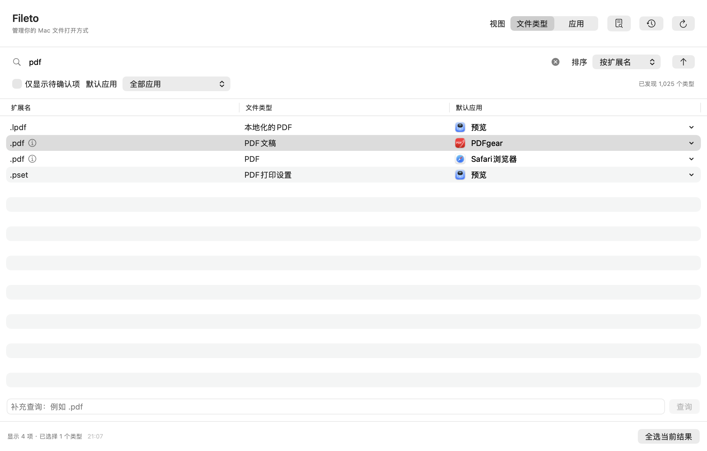

# Fileto

Fileto 是一个原生 macOS 文件默认打开方式管理工具，使用 Swift、SwiftUI 和 AppKit 构建。你可以按文件类型查询默认应用、按应用查看关联范围，并预览、批量修改或恢复文件类型的默认打开方式。

最低支持 macOS 13；没有第三方包依赖、账号、云端服务或后台守护进程。

## 功能

- **文件类型查询**：搜索扩展名、类型名称或默认应用，筛选待确认项，查看默认应用和候选应用。
- **应用反向查询**：区分某个应用“当前默认负责”的类型和“可用于打开”的类型。
- **真实文件查询**：拖入文件或通过“查询文件”选择文件，查看其内容类型与实际打开应用；也可输入扩展名补充查询。
- **单项与批量修改**：行内菜单选择候选应用后直接修改；支持 Command / Shift 多选、全选当前结果，批量先预览支持范围与跳过项，再顺序执行并逐项重新查询验证。
- **历史与恢复**：本机保留最近 30 次操作，可重新预览未完成项，也可预览恢复到修改前的应用。
- **外部变化自动刷新**：切回 Fileto 时自动重新发现和查询，前台主窗口可见时每 30 秒检查已发现类型的关联；弹窗和修改期间延后。



更多界面截图与验证流程见 [实现与验证](docs/verification.md)。

## 环境要求

| 项目 | 要求 |
| --- | --- |
| 操作系统 | macOS 13 或更新版本 |
| 构建工具 | Xcode，需包含 Swift、macOS SDK 与图标资产编译工具 |
| Swift Package 工具版本 | 5.9 或更新版本，见 `Package.swift` |
| 系统集成验证 | 普通 macOS 用户会话、Python 3；运行期间需手动完成系统确认 |

macOS 13 是部署目标。现有验收记录来自 Apple Silicon；Intel 和其他 macOS 版本仍需对应机器实测。

## 构建与运行

在项目根目录执行：

```bash
bash scripts/build.sh
open dist/Fileto.app
```

默认构建 Release 配置，产物为 `dist/Fileto.app` 和命令行诊断工具 `dist/fileto-probe`。应用使用本机 ad-hoc 签名，构建脚本会进行严格签名校验。

需要 Debug 配置时：

```bash
bash scripts/build.sh debug
```

构建 DMG 安装映像：

```bash
bash scripts/build.sh --format dmg
```

默认输出 `dist/Fileto.dmg`，其中包含 `Fileto.app`、指向 `/Applications` 的快捷方式和中文安装说明。打开 DMG 后，将 Fileto 拖入 Applications，再从“应用程序”中启动。DMG 使用 macOS 自带的 `hdiutil` 创建压缩只读映像，并在输出前校验映像完整性。

可以指定构建配置和完整产物路径：

```bash
bash scripts/build.sh --format app --output dist/custom/Fileto.app
bash scripts/build.sh --format dmg --output "dist/Fileto 安装包.dmg" --configuration release
bash scripts/build.sh --version 0.2.0 --build-number 2
bash scripts/build.sh --format dmg --version 0.2.0 --build-number 2
bash scripts/build.sh --help
```

| 选项 | 说明 |
| --- | --- |
| `-f, --format app\|dmg` | 默认 `app`；分别生成应用包目录或 DMG 文件 |
| `-o, --output PATH` | 完整产物路径，后缀须与格式对应；默认项目根目录下的 `dist/Fileto.app` 或 `dist/Fileto.dmg` |
| `-c, --configuration debug\|release` | 默认 `release`；继续兼容原来的位置参数 `debug` / `release` |
| `-v, --version VERSION` | 三段数字版本号（如 `0.2.0`），写入应用包的 `CFBundleShortVersionString`；默认读取 `Resources/Info.plist` |
| `-b, --build-number NUMBER` | 1 至 3 段数字构建号（如 `2` 或 `2.1.0`），写入应用包的 `CFBundleVersion`；默认读取 `Resources/Info.plist` |
| `-h, --help` | 显示用法，不执行构建 |

选项支持 `--format=dmg` 等等号写法。相对输出路径以调用脚本时的工作目录为准，父目录自动创建；已有同类产物会在构建和校验成功后替换。拒绝将输出写入符号链接或将普通目录当作应用包覆盖。诊断工具仍固定输出到项目 `dist/fileto-probe`；DMG 模式只输出映像，不额外更新 `dist/Fileto.app`。

版本选项同时适用于 APP 和 DMG 中的应用，只修改本次产物，不改写源码中的 `Resources/Info.plist` 或 Xcode 配置。例如 `--version 0.2.0 --build-number 2` 会使“关于 Fileto”显示 `版本 0.2.0 (2)`；未指定时沿用 plist 中的默认版本。

也可以在 Xcode 中打开 `Fileto.xcodeproj`，选择 **Fileto** Scheme 和 **My Mac**，再按 **⌘R** 运行。该工程会生成包含应用标识、Info.plist 和图标的完整应用包；核心模块复用本地 Swift Package。

Xcode Debug 使用 `com.fileto.app.debug`，Xcode Release 和脚本打包使用 `com.fileto.app`。更改应用标识后，应先停止旧进程再重新运行。

直接打开 `Package.swift` 适合模块开发和测试，但其中的 Fileto Scheme 运行的是裸可执行文件，不具备完整应用包的系统身份。

## 使用方式

1. 在“文件类型”视图搜索目标类型，或在“应用”视图选择应用并切换“当前默认负责”／“可用于打开”范围。两个视图共用类型表格；左侧应用只用于筛选，不代表修改目标。
2. 点击某行“默认应用”展开带图标的应用菜单，当前默认应用带勾选标识。选择新应用后直接检查当前关联并进入系统流程，不再弹出应用选择或修改预览。行内修改仅处理被点击的类型，即使表格已有多选。
3. “其他应用…”可浏览本机应用，随后保留应用选择界面，查看目标和影响后点击“修改”；仍需通过系统候选范围检查。双击扩展名或文件类型，或右键选择“查看详情…”，可查看类型与应用信息；UTI、Bundle ID 和路径在“高级信息”中展开。查询文件后会自动打开详情，展示实际打开应用及与类型默认值的差异。
4. 使用 Command / Shift 多选，或点击“全选当前结果”；选中多个可见类型后，右下角出现“更改 N 个类型…”。点击后通过弹窗选择目标应用，查看预计需修改、无需修改和跳过的数量；没有需修改项时会说明原因并禁用“开始修改”。“查看所选类型…”打开扩展名、文件类型、当前默认应用和逐项处理方式的明细表，关闭后保留已选应用。汇总和影响说明在选择界面中展示，点击“开始修改”直接进入系统流程。计数单位为类型，同一类型的多个扩展名共同受影响。
5. macOS 可能对每个类型分别要求确认，需要手动完成；批量修改不代表一次授权全部类型。普通单项修改成功后显示“已修改并验证”的短提示；无需重复设置时也用短提示说明。失败、取消、冲突、待验证和历史保存失败仍显示结果详情；批量、恢复和重试保留逐项结果。通过历史按钮可重新预览失败项或有条件恢复原应用；待验证、取消与冲突项先刷新核对，再重新选择和预览。

执行时底部显示实际已处理数量、当前类型和等待系统设置或读回验证的阶段。停止按钮会在当前项结束后停止后续修改。结果分别列出已修改并验证、失败、待验证、无需修改、冲突、取消及跳过项。查询失败保留并标记上次结果。

修改结束后复用执行前检查与读回验证的系统查询结果，只更新本次涉及的类型和应用负责数量，不重新扫描应用目录或查询全部类型；结果提示不等待全量刷新。在“当前默认负责”范围中，改给其他应用的类型会移出当前列表；“可用于打开”范围仍按系统候选应用查询决定。单项成功提示包含扩展名与目标应用，列表移出后仍可通过历史查看和恢复；其他情况的结果弹窗保留本次逐项记录。关闭窗口会停止后续项，当前系统请求继续等待并保存结果；操作结束前退出应用会提示继续等待。

在菜单栏选择 **Fileto → 关于 Fileto**，可查看软件简介和版本，点击“访问官网”打开项目的 GitHub 页面。
应用菜单保留 Fileto、编辑、文件关联和窗口；“文件关联”提供刷新（⌘R）与查询文件（⌘O），“窗口”提供切换全屏（⌃⌘F）。

如果扩展名对应多个类型，拖入真实文件可以帮助确认其内容类型。切换到“应用”视图可查看该应用在已发现类型中的默认关联和候选范围。

在 Finder 或其他工具中修改打开方式后，切回 Fileto 会在约 1 秒后开始完整刷新。持续处于前台时，每 30 秒检查默认与候选应用；后台、隐藏、主窗口最小化或系统休眠期间暂停。刷新仍需系统查询时间，并非即时变化通知。

自动刷新保留搜索、筛选、排序和有效选择，静默更新列表、反向查询与所查询文件的实际打开应用。候选选择、所选类型明细、预览、历史等弹窗打开时延后；修改和系统确认期间也延后；操作结束后先更新本次涉及的类型并反馈结果，积累的外部变化检查随后按前台空闲规则静默执行。已有预览、历史及处理结果不会被自动改写；执行前继续检查关联冲突。查询失败时保留旧结果并显示刷新提示，所查询文件无法访问时会明确标记为上次结果。

## 数据与产品边界

默认关联以系统查询为准。Fileto 通过 `NSWorkspace` 查询和修改关联，不维护独立的默认应用数据库。

- 列表来自常见类型、常用应用目录中的类型声明和用户补充查询，代表**已发现的类型**，不代表系统全部关联。
- 每行对应一个具体 UTI（统一类型标识符）。多个扩展名可以共用同一 UTI；同扩展名对应多个 UTI 时会保留多行。
- 应用声明用于发现类型；默认应用和候选应用来自系统查询。系统未声明的扩展名可能生成动态类型，这不意味着关联损坏。
- 批量操作按类型去重，顺序执行并逐项读回验证。如果关联在行内菜单或应用选择界面展示后发生变化，该项会跳过。
- 只修改文件类型的默认应用。具体文件的实际打开应用可能不同；当前不支持单文件覆盖、URL scheme 或 Launch Services 数据库修复与重建。
- 恢复会重新设置原应用，并再次预览和验证。无原应用、原应用已不可用，或当前关联已被再次修改的项目不会恢复。

操作记录保存在本机：

```text
~/Library/Application Support/Fileto/history.json
```

记录包含类型、应用信息、逐项结果和错误代码，不保存用户文件内容。真实文件查询结果只保留在当前界面状态。

## 项目结构

```text
Fileto/
├── Package.swift                 # Swift Package 与目标定义
├── Fileto.xcodeproj/             # 完整 macOS 应用工程与共享 Scheme
├── Sources/
│   ├── FiletoApp/                # SwiftUI 界面、应用状态与图标资源
│   ├── FiletoCore/               # 类型发现、关联操作、系统适配与历史存储
│   └── FiletoProbe/              # 命令行查询与原生界面验证启动器
├── Tests/                       # 核心模块与自动刷新状态协调测试
├── Resources/                   # Info.plist 与源图标
├── scripts/                     # 构建、图标生成与系统验证脚本
└── docs/                        # 公开实现说明、验证流程与界面截图
```

主要调用链：

```text
ContentView / ChangeSheets → AppModel → AssociationManager → SystemWorkspace → NSWorkspace
```

类型目录在后台读取，查询分批让出主线程。界面与核心模块通过普通数据模型交互，核心模块不依赖 SwiftUI。

`.gitignore` 排除 SwiftPM / Xcode 本地产物、个人工作区状态和 `dist` 打包目录，保留共享 Scheme、图标资源和公开文档截图。`docs/local/` 存放不公开的本机排查与验收记录，并由 Git 忽略。

## 开发与验证

编译与核心模块测试：

```bash
bash scripts/swift.sh build
bash scripts/swift.sh test
```

只读系统查询（先完成上述编译）：

```bash
.build/debug/fileto-probe pdf jpg md json
.build/debug/fileto-probe --catalog
.build/debug/fileto-probe --file /absolute/path/to/sample.json
```

隔离系统与原生界面验证：

```bash
# Debug 配置
bash scripts/system-smoke.sh

# Release 交付配置
bash scripts/system-smoke.sh release
```

验证脚本在 `dist` 下创建两个临时 AppKit 应用，只声明 `filetovalidationone` / `filetovalidationtwo` 测试扩展名。它会启动真实签名的 Fileto.app，验证单项与批量修改、重新查询、历史持久化、恢复和真实文件打开事件。运行时 Fileto 测试窗口会显示在前台，需手动完成 macOS 默认应用确认。

脚本结束后关闭、注销并删除临时应用，将截图和操作记录保存到 `.build/ui-smoke/`。系统可能保留专用测试类型的缓存记录；脚本不清理全局关联数据库，也不修改 PDF、图片或代码等日常文件类型。

受限执行沙盒可能导致 Launch Services 查询失败，或让标准类型表现为动态类型。系统集成验证应在普通用户终端执行。验证流程与平台限制见 [实现与验证](docs/verification.md)。每次验收应记录日期、平台与执行范围，历史结果不能替代本轮验证。

## 发布

本机构建默认采用 ad-hoc 签名，设置 `FILETO_SIGN_IDENTITY` 时使用指定身份签署应用。APP 和 DMG 两种输出沿用相同的应用签名流程；脚本不自动签署或公证 DMG。DMG 是分发容器，不会消除未公证应用的打开提示。

对于未公证版本，应向用户说明：在确认应用来源可信后，如果 macOS 阻止打开，先尝试启动安装后的应用，再进入“系统设置 → 隐私与安全性”，在本次阻止记录旁选择“仍要打开”，按系统提示确认。具体步骤见 [Apple 官方说明](https://support.apple.com/zh-cn/102445)。

需要经过 Apple 认可的分发流程时，使用发布者的 Developer ID 签名并进行 Apple 公证。现有 ZIP 发布流程：

```bash
FILETO_SIGN_IDENTITY='Developer ID Application: Your Name (TEAMID)' bash scripts/build.sh
ditto -c -k --keepParent dist/Fileto.app dist/Fileto.zip
xcrun notarytool submit dist/Fileto.zip --keychain-profile YOUR_PROFILE --wait
xcrun stapler staple dist/Fileto.app
```

将签名身份和已配置的公证凭据配置名称替换为自己的值；凭据不写入仓库。如果分发 ZIP，应在 stapler 完成后重新打包应用：

```bash
ditto -c -k --keepParent dist/Fileto.app dist/Fileto.zip
```

当前构建针对本机架构。应用为普通非 App Sandbox 桌面应用，尚未验证 Mac App Store 发行。

## 常见问题

**Xcode 更新图标后仍显示旧图标或占位图标？**

从旧图标资源配置升级时，先停止旧进程，再执行 **Product → Clean Build Folder（⇧⌘K）** 并重新构建。完整应用包应同时包含 `Assets.car` 和 `Info.plist` 指向的 `AppIcon.icns`。补齐资源和编译通过仍不能替代 Dock、应用切换或台前调度的实际画面验收。

**为什么列表里找不到某个扩展名？**

列表是已发现类型的集合。可以输入扩展名补充查询，或拖入真实文件确认其内容类型。

**为什么执行后显示“待验证”或跳过？**

系统接受设置请求但尚未读回目标应用时会显示“待验证”；关联在预览后改变时会跳过。请完成系统确认，再刷新查询或从历史中重新预览。

## 相关文档

- [操作提示规范](docs/UX_FEEDBACK.md)：提示呈现、结果文案、持续状态与交互验收规则。
- [实现与验证](docs/verification.md)：修改和恢复规则、验证流程、界面展示与平台限制。
- [图标设计](docs/icon-design.md)：应用图标设计与资源说明。
