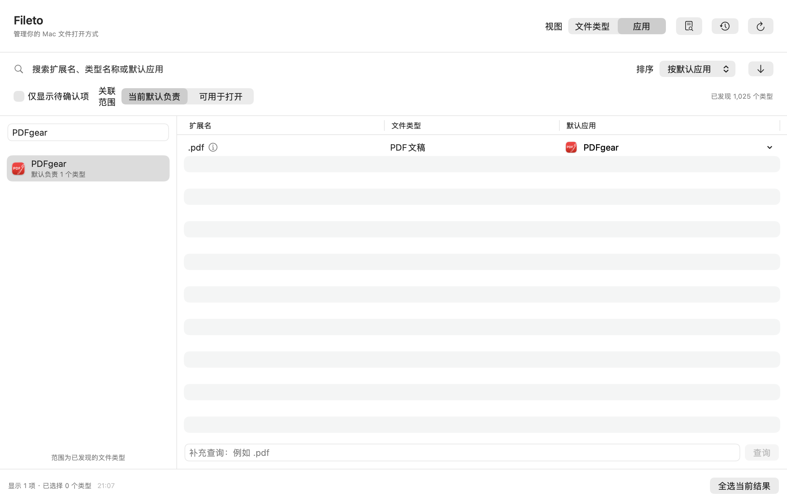

# Fileto 实现与验证

## 实现范围

Fileto 使用 SwiftUI / AppKit，最低部署版本 macOS 13。核心能力通过公开 `NSWorkspace` 与 `UniformTypeIdentifiers` API 实现，不依赖私有框架、系统数据库编辑或外部命令来修改关联。

| 阶段 | 已实现能力 | 实现入口 |
| --- | --- | --- |
| 1：系统能力 | 扩展名解析为一个或多个 UTI、查询默认/候选应用、异步设置默认应用、重新查询验证、真实文件解析 | `FiletoCore/TypeCatalog.swift`、`SystemWorkspace.swift`、`AssociationManager.swift` |
| 2：单项闭环 | 发现类型、搜索/筛选/排序、详情、候选选择、补充扩展名查询、文件选择/拖入、修改预览、执行结果 | `FiletoApp/ContentView.swift`、`ChangeSheets.swift`、`AppModel.swift` |
| 3：反向与批量 | 按应用查看当前默认类型及候选范围、多选/全选、覆盖范围与跳过项目、逐项结果、停止后续项、失败项重新预览、历史与恢复 | `AppModel.swift`、`AssociationManager.swift`、`HistoryStore.swift` |

数据从系统查询产生。应用目录中的声明仅用于发现类型；反向查询按已发现类型构建，不能解释为系统全部关联。当前只扫描 `/Applications`、`~/Applications`、`/System/Applications`、`/System/Library/CoreServices` 中的有界目录层级，不扫描用户文档。

一条记录对应一个 UTI，而不是一个扩展名。共享 UTI 的扩展名共同受影响；同扩展名对应不同 UTI 时保留多个结果。动态类型、没有默认应用与查询失败分别表达，不推断系统损坏。

## 修改与恢复规则

1. 行内菜单直接选择候选后提交，保留菜单所展示的默认应用快照。“其他应用…”及批量修改保留应用选择界面，提交计划使用该展示快照，不再打开独立预览。普通单项成功或已是默认时只显示短提示，其他结果以及批量、恢复与失败重试保留结果详情；操作记录仍保存。恢复与失败重试仍重新查询并显示预览。
2. 执行前重新查询：已是目标则无需修改；与预览不同则跳过；目标不再是系统候选则失败。
3. 按类型顺序调用系统设置，逐项重新查询。只有读回目标应用才显示“已修改”。系统接受请求但未读回目标时显示“待验证”。
4. 系统确认由用户完成；取消作为取消结果保存。停止按钮在当前项结束后停止后续项，不中断正在进行的系统确认。
5. 恢复只处理曾修改或待验证、有原应用、当前仍为目标且原应用仍可用的项目。恢复也经过预览、并发变化检查与读回验证。

最近 30 次记录以原子 JSON 文件写入 `~/Library/Application Support/Fileto/history.json`。记录存储类型及应用信息、逐项结果和错误代码，不存储被查询文件的内容；文件查询只保留在当前界面状态。

## 外部变化自动刷新

`AutomaticRefresh` 统一持有应用生命周期通知、主窗口弱引用、定时器和单个刷新任务。切回前台或从休眠恢复后，在主窗口可见且未选择候选应用、无弹窗、无修改任务时，合并请求并延迟约 1 秒完整刷新。前台空闲每 30 秒只查询已发现类型，不重新扫描应用目录。主窗口关闭、最小化、应用隐藏、退到后台或系统休眠时暂停。

`AppModel` 在主线程分批查询，完整发现继续使用后台任务。自动检查保留原列表，完成后统一提交；途中打开弹窗、失去前台资格、开始修改或补充查询时，放弃该轮快照并保留待刷新请求。原生 sheet 实际关闭后才补查。手动刷新会取消并等待自动任务，再承担已有刷新请求；修改开始前也取消并等待自动任务，避免并发查询和系统确认期间反复扫描。修改结束后复用执行期间已完成的系统查询快照，一次更新本次实际查询过的类型，不重新发现应用或查询其他类型；结果反馈不等待全量刷新。修改期间积累的外部变化请求保留，之后按前台空闲规则静默检查。

刷新保留搜索、排序、有效类型选择与应用筛选；应用已不在发现和系统查询结果中时清理失效选择。系统查询失败保留该类型上次结果并显示提示；应用目录读取失败时保留已发现类型。完整刷新时文件详情重新查询实际打开应用，读取失败时明确标记旧结果；修改后仅补查与本次类型相关的文件打开方式，保留具体文件的独立偏好和查询失败时的旧结果。增量更新不改写全量刷新时间，也不清除其他类型的查询故障。预览计划、历史及执行结果保留为当时快照，关联写入与条件恢复规则不变。

## 自动化验证

`bash scripts/swift.sh test` 同时运行核心和应用状态协调测试。核心测试覆盖共享扩展名与不同 UTI、声明优先级、输入规范化、目标支持检查、预览后冲突、重复设置、部分失败、停止、未验证结果、系统取消、条件恢复、无原应用边界、历史持久化与数量限制。

`bash scripts/system-smoke.sh` 会构建真实签名应用、注册两个临时 AppKit 应用，只对 `filetovalidationone` / `filetovalidationtwo` 写入系统关联。测试通过真实 `AppModel` 验证原生界面、单项与批量修改、重新查询、反向索引、持久化、恢复，以及通过系统默认打开方式将样本文件交付给测试应用。系统确认期间需要用户点击允许更改；测试窗口会显示在前台。测试有三分钟上限，结束后关闭、注销并删除临时应用，不重建系统关联数据库。

测试证据在 `.build/ui-smoke/`：`smoke-result.txt`、`smoke-history.json` 与界面截图。截图由实际原生视图离屏渲染得到，不能替代所有人工操作验收。

## 类型表格与弹窗验收范围

`DetailFlowTests` 使用独立临时历史与 `WorkspaceAccess` 测试替身，覆盖两个视图的行内修改、详情与候选弹窗和系统结果之间的协调；`AssociationManagerTests` 覆盖实际核心规则。这些测试不调用真实系统写入。

| 场景 | 自动化覆盖 | 人工桌面检查 |
| --- | --- | --- |
| 正常查询与单项修改 | 保留行内菜单或选择界面原值、目标、扩展名；读回后更新列表与反向索引，普通单项成功用短提示 | 专用夹具的真实设置与重新查询 |
| 取消选择或确认 | 不发起系统写入；取消的预览不能再次提交 | Escape 与原生关闭交互 |
| 选择当前默认应用 | 修改按钮禁用；批量无需修改项不重复写入 | 列表标识与键盘选择 |
| 没有默认应用 | 可选择系统候选并修改，不承诺恢复 | 无默认应用文案 |
| 目标不可用 | 预览后候选消失不写入；浏览的未支持应用不能继续 | 真实应用被移动或删除 |
| 系统拒绝或取消 | 区分失败与取消，保留错误代码和查询值 | 手动拒绝或取消系统提示 |
| 读回未更新或查询失败 | 系统接受后保留待验证；旧详情标记；刷新恢复 | 系统延迟生效 |
| 批量全部成功或部分成功 | 逐项结果与保存；失败项重试，不重放已成功或待验证项 | 专用夹具真实批量设置 |
| 行内修改与批量选择 | 两个视图多选后行内选择候选直接提交且只处理点击的 UTI；批量不包含筛选后隐藏行；关闭选择弹窗不能提交旧目标 | 菜单勾选、应用图标、“其他应用…”及右下角按钮 |
| 候选选择说明与明细 | 按系统候选范围分别统计需修改、已是默认与不支持项；零修改禁用修改按钮，部分支持显示跳过汇总 | 独立四列表格、关闭明细保留已选应用、浅深色菜单按下时图标保持原色 |
| 应用筛选后的结果 | 默认负责范围移出已修改类型并更新数量；候选范围保留系统支持的类型；单项成功提示标明类型与目标，记录仍可查看 | 修改后的列表变化、同名应用路径 |
| 详情入口与文件查询 | 详情绑定具体 UTI、保留多选；查询文件自动显示详情；关闭详情后恢复自动刷新 | 双击、右键、Escape、具体文件打开方式差异 |
| 快速切换 | 候选加载和确认准备中丢弃旧选择快照；自动刷新延后 | 连续选择与加载文案 |
| 操作中关闭窗口 | 离屏 AppKit 窗口通知停止后续项，当前请求完成并保存 | 实际关闭、重开和退出时的系统提示 |
| 窗口尺寸 | 只读原生渲染覆盖 960×600、1160×740、1440×900 | 双击与右键详情、行内菜单、Command / Shift 多选、候选独立滚动、长文案、深色模式 |
| 辅助功能 | 原生 List、DisclosureGroup、键盘确认/取消及控件标签 | VoiceOver、Tab/方向键、减少动态效果 |

候选弹窗查询和修改计划准备每 20 项让出主线程，并使用选择版本号防止旧异步任务提交。默认应用查询失败与“没有默认应用”分别显示。进度只统计真实逐项结果；等待 macOS 设置时提示用户完成系统确认，不推测确认窗口是否已经出现。窗口关闭不取消已经提交的系统请求，也不回滚已完成项。

批量候选查询显示已查询类型的进度，修改计划准备显示已准备类型的进度。查询完成后一次合并主列表，只在数据变化时重建应用索引；候选支持数量、当前默认数量、同名提示及排序按选择快照预计算。修改计划复用选择界面已展示的查询快照，不重新查询后静默替换原应用；执行前的重新查询、冲突检查和修改后的读回验证继续独立进行。选择目标变化或关闭选择界面时清除未提交的计划，提交后等待原生弹窗实际关闭才发起系统设置。`BatchPerformanceTests` 覆盖 1,025 个类型的批量提交次数、查询次数、顺序和快照一致性；`DetailFlowTests` 另覆盖在 1,025 个类型中修改单项时不扫描目录、不查询无关类型、不进入阻塞扫描，直接复用已验证的查询结果。两者都以查询范围与调用次数验证，不以机器相关的耗时作为通过条件。

无需系统写入的完整应用渲染检查（先完成 Debug 打包）：

```bash
.build/debug/fileto-probe --run-ui-smoke "$PWD/dist/Fileto.app" "$PWD/.build/detail-ux-smoke"
```

该入口查询真实系统关联、检查搜索和选择、生成原生界面截图，并对全部已发现类型查询候选、准备后取消预览；批量耗时写入输出目录的 `batch-performance.txt`。未提供两个专用测试应用路径时不会修改默认关联。部分 Mac 的 JSON 类型可能只有当前应用，此时选择预览检查会说明没有可验证的其他候选。

需要显示测试窗口并检查原生控件动作时，可增加只读交互参数：

```bash
.build/debug/fileto-probe --run-ui-smoke "$PWD/dist/Fileto.app" "$PWD/.build/table-interaction-smoke" --interactions
```

该参数验证两个视图的原生表格选择、应用菜单图标与当前默认标识、辅助功能批量按钮到选择弹窗，以及详情呈现和 Escape 关闭。文件类型视图通过原生 Table 鼠标回调触发详情；应用视图检查共享双击动作的注册，并单独验证筛选下的详情呈现。所有预览均取消；候选菜单只检查内容而不触发选择，避免直接提交日常类型的修改。不执行系统关联写入；历史使用输出目录中的独立文件。专用类型系统验证覆盖单项直接提交、读回成功短提示、历史与恢复。

这些控件检查与浅色／深色离屏渲染仍不能替代完整人工鼠标、Command／Shift、VoiceOver 和系统确认验收。真实关联修改仍使用上面的专用类型系统验证脚本。


## 界面展示

以下截图展示文件类型查询和应用反向查询，列表内容会随本机已安装应用与关联状态变化。




## 平台与交付限制

macOS 13 是编译部署目标；不同 macOS 版本和处理器架构需要对应机器实测。普通用户会话中的系统结果有效，受限沙盒内的 Launch Services 查询不能用作验收依据。编译、模拟测试与离屏渲染截图不能替代系统确认、自动刷新或台前调度的人工桌面验收。

默认构建是本机 ad-hoc 签名；Developer ID 签名与 Apple 公证流程见 [README 的发布说明](../README.md#发布)。应用使用普通桌面权限，没有 App Sandbox、后台守护进程、网络服务或账号系统。尚未验证 Mac App Store 发行。

不包含单文件打开方式修改、URL scheme、关联数据库修复/重建、清理功能或 AI 功能。
